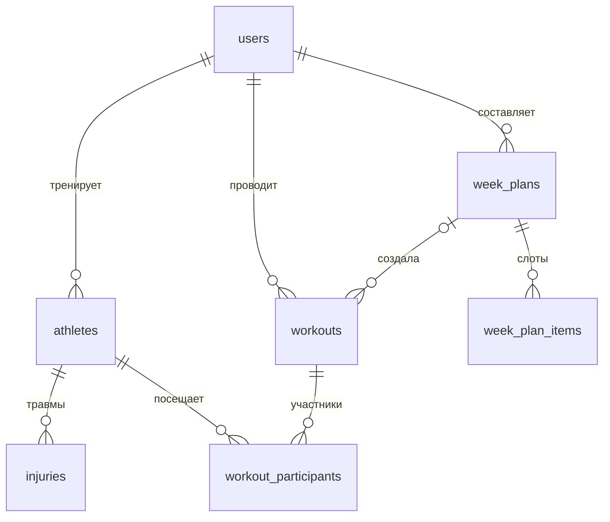

# Тренерская — приложение для тренера

Веб-приложение, в котором тренер ведёт список своих спортсменов, планирует тренировки по неделям, отмечает посещаемость, фиксирует травмы и план питания и смотрит простые отчёты.

Проект состоит из **frontend** (React + TypeScript, пока на демонстрационных данных) и **backend** (FastAPI + PostgreSQL + SQLAlchemy). Подключение фронтенда к API — следующий этап.

## Для кого и зачем

Для тренера, который работает с несколькими спортсменами и хочет держать в одном месте расписание, посещаемость, травмы и питание. Спортсмены в приложении — это записи тренера, своих аккаунтов у них нет. Групп нет: тренировка связана с конкретными спортсменами.

## Основные сценарии

1. Войти в личный кабинет.
2. Добавить спортсмена, найти его через поиск, отфильтровать по статусу или наличию травмы.
3. Открыть карточку спортсмена: профиль, общий план питания, травмы, история посещаемости.
4. Открыть календарь, выбрать год и месяц, увидеть тренировки по дням со временем.
5. Добавить тренировку. Тренировки одного тренера не должны пересекаться по времени: при пересечении форма показывает ошибку.
6. Открыть тренировку и отметить, кто был, кто не был и у кого уважительная причина.
7. Составить недельный шаблон и применить его на несколько недель вперёд.
8. Посмотреть отчёт по посещаемости и травмам за период.

## Экраны и маршруты

| Маршрут | Экран |
|---|---|
| `/login` | Вход |
| `/` | Личный кабинет: профиль, сводка, ближайшие тренировки |
| `/athletes` | Список спортсменов, поиск, фильтры, добавление |
| `/athletes/:id` | Карточка: профиль, питание, травмы, посещаемость |
| `/calendar` | Календарь с выбором года и месяца, добавление тренировки |
| `/workouts/:id` | Тренировка и отметка посещаемости |
| `/week-plans` | Недельные шаблоны и повтор на N недель |
| `/reports` | Отчёты за период |

## Стек

- React 18 + TypeScript, Vite
- React Router 6 (клиентская маршрутизация)
- Ant Design 5 (UI-библиотека), dayjs
- FastAPI, SQLAlchemy 2, PostgreSQL 16, Pydantic 2
- Docker и docker compose

UI-библиотека одна на весь проект, единая тема задана в `frontend/src/app/theme.ts`. Календарь, таблицы и формы взяты из Ant Design, поэтому оформление и читаемость единые. Интерфейс адаптивный: на узких экранах боковое меню сворачивается, таблицы прокручиваются по горизонтали, календарь переключается в компактный вид.

## Быстрый старт (всё в Docker)

```bash
cp .env.example .env     # задайте пароль БД и SECRET_KEY
docker compose up --build
```

Frontend: http://localhost:5173, API: http://localhost:8000, документация API: http://localhost:8000/docs.

## Запуск frontend

```bash
docker compose up --build
```

Приложение откроется на http://localhost:5173.

Продакшен-сборка через nginx:

```bash
docker compose --profile prod up --build frontend-prod
```

Откроется на http://localhost:8080.

### Без Docker

Нужен Node.js 20+.

```bash
cd frontend
npm install
npm run dev
```

Проверка типов и сборки: `npm run build`.

## Архитектура frontend

Код frontend разделён по упрощённой схеме Feature-Sliced Design. Слои зависят только «вниз»: `app → pages → features → entities → shared`. Каждый слайс (папка) открывает наружу только `index.ts`, остальное внутри считается приватным. Для импортов настроен алиас `@/` (корень `src`).

```
frontend/src/
  app/         настройка приложения: провайдеры (тема, локаль, роутер), маршруты, общий layout, глобальные стили
  pages/       страницы: собирают экран из фич и сущностей (login, dashboard, athletes, athlete-details,
               calendar, workout-details, week-plans, reports)
  features/    пользовательские действия: формы и операции
    auth-login, athlete-create, athlete-filters, athlete-nutrition, injury-manage,
    workout-create, attendance-mark, week-plan-slots, week-plan-apply, profile-edit, simulate-failure
  entities/    предметные сущности: типы, работа с данными и мелкие UI-элементы
    athlete, injury, workout, week-plan, coach, report
  shared/      общее без бизнес-смысла: api-клиент, хуки, правила валидации, форматирование, UI-компоненты
```

Что за что отвечает:

- **pages** не содержат бизнес-логики форм, только раскладка и загрузка данных.
- **features** отвечают за действие пользователя целиком: форма, валидация, вызов API, реакция на успех и ошибку. Каждая фича используется на одной-двух страницах.
- **entities** хранят типы и методы доступа к данным (`athleteApi`, `workoutApi` и др.) и небольшие повторно используемые элементы (`AthleteStatusTags`, `SeverityTag`, `AttendanceTag`).
- **shared** содержит `useQuery`, `AsyncState`, `PageHeader`, `Expandable`, правила валидации `rules`, форматирование дат, маршруты. Дублирования нет: например, правила телефона и обязательных полей объявлены один раз и используются во всех формах.

Отступления от канонического FSD:

- Нет слоя `widgets`: общий каркас с меню лежит в `app/layouts`.
- Демо-«база» `shared/api/mockDb.ts` импортирует типы сущностей. Это временное исключение: при подключении настоящего API файл удаляется, а `entities/*/api` начнут обращаться к backend.

### Работа с данными и состояния экранов

До интеграции с backend данные берутся из демо-базы в памяти через асинхронные функции с задержкой, которые ведут себя как сетевые запросы. Данные живут до перезагрузки страницы.

Экраны с данными показывают все три состояния через единый компонент `AsyncState`:

- **загрузка**: скелетон;
- **ошибка**: сообщение и кнопка «Повторить»;
- **нет данных**: пояснение, что делать дальше (например, «Ничего не найдено. Измените поиск или фильтр»).

Чтобы увидеть ошибку, в шапке есть демо-переключатель «Сбой сети»: включите его и обновите данные (например, введите символ в поиск спортсменов).

### Формы и валидация

Все формы на Ant Design Form с типизированными значениями. Клиентская валидация показывает ошибку под полем:

| Форма | Проверки |
|---|---|
| Вход | email по формату, пароль от 8 символов; неверный пароль приходит как ошибка с «сервера» (демо-пароль `demo1234`) |
| Новый спортсмен | имя обязательно, рост 50–250, вес 20–300, формат телефона, дата рождения не в будущем |
| Травма | название и область обязательны, дата не в будущем, заметка до 5000 символов |
| Тренировка | название, дата, время, конец позже начала; пересечение с другой тренировкой возвращается ошибкой у поля времени |
| Слот недельного шаблона | название, время, пересечение слотов в один день |
| Применение шаблона | дата и количество недель 1–26 |
| Профиль, питание | обязательное имя, формат телефона, ограничения длины |

Сообщения об ошибках сервера (`ApiError`) отображаются в самой форме, а не только во всплывающем уведомлении.

### Интерактивность и анимации

- Фильтры спортсменов (поиск с задержкой 300 мс и переключатель статуса), календарь с выбором года и месяца, добавление и просмотр тренировок.
- Отметка посещаемости: переключатели по строкам, «Отметить всех», индикатор несохранённых изменений и прогресс отметок. Кнопка сохранения активна, только если есть изменения.
- Архивирование и удаление спортсмена, закрытие и удаление травм с подтверждением.
- Недельный шаблон: добавление и удаление слотов, повтор шаблона на N недель с отчётом о пропущенных пересечениях.
- Анимации: плавное появление страницы при переходе, раскрытие встроенной формы травмы, подсветка только что добавленной строки таблицы, появление блоков данных, лёгкий подъём карточек статистики. При включённом в системе режиме «уменьшить движение» отключаются только собственные анимации; анимации Ant Design (окна, выпадающие списки) не трогаем, иначе модальные окна зависают.

## Запуск проверки сценариев

Быстрый ручной прогон после запуска приложения:

1. `/login`: введите неверный пароль, затем `demo1234`, должен открыться кабинет.
2. Кабинет: «Изменить» профиль, очистите имя (ошибка валидации), затем сохраните.
3. Спортсмены: поиск, фильтр «С травмой», «Добавить спортсмена» (сначала пустая форма, потом корректная), новая строка подсвечивается.
4. Карточка спортсмена: вкладки, сохранение плана питания, добавление и закрытие травмы, «В архив».
5. Календарь: смена года и месяца, «Добавить тренировку» с пересекающимся временем (ошибка у поля), затем со свободным.
6. Тренировка: отметки посещаемости, «Сохранить», возврат в календарь и проверка в карточке спортсмена.
7. Планы недель: добавление и удаление слота, применение шаблона на 4 недели.
8. Отчёты: смена периода, пустой период.
9. Включите «Сбой сети» и проверьте экран ошибки и кнопку «Повторить».
10. Навигацию меню на всех страницах и на узком экране (меню сворачивается).

## Скриншоты

Лежат в `docs/screenshots`. Обновляются скриптом после любых изменений интерфейса:

```bash
cd frontend
npm install
npx playwright install chromium
npm run dev            # в соседнем терминале
npm run screenshots
```

Скрипт сохраняет:

| Файл | Экран или состояние |
|---|---|
| `01-login` | Вход |
| `02-dashboard` | Личный кабинет |
| `03-athletes` | Список спортсменов |
| `04-athlete-profile` | Карточка спортсмена |
| `05-calendar` | Календарь |
| `06-workout-attendance` | Тренировка и посещаемость |
| `07-week-plans` | Планы недель |
| `08-reports` | Отчёты |
| `09-mobile-athletes` | Список спортсменов на телефоне |
| `10-state-loading` | Состояние загрузки |
| `11-form-validation` | Ошибки валидации формы |
| `12-state-empty` | Пустой результат поиска |
| `13-state-error` | Ошибка загрузки |
| `14-injury-form-expanded` | Раскрытая форма травмы |

## Backend

### Структура

```
backend/
  app/
    main.py            приложение FastAPI, обработчики ошибок, CORS
    core/config.py     настройки из переменных окружения
    core/security.py   хеширование паролей (bcrypt), JWT
    database.py        подключение, сессии, создание таблиц
    models.py          модели SQLAlchemy
    schemas.py         схемы валидации запросов и ответов (Pydantic)
    errors.py          бизнес-ошибки
    services/          операции с данными и бизнес-логика
    api/routes/        маршруты API
  tests/               тесты API (pytest)
```

Маршруты только принимают запрос и отдают ответ, вся логика и работа с БД в `services/`.

### Модель данных



| Таблица | Назначение и ключевые поля |
|---|---|
| `users` | Тренер: `email` (уникальный), `password_hash`, `full_name` |
| `athletes` | Спортсмен тренера: `coach_id`, ФИО, рост, вес, телефон, заметки, общий план питания `nutrition_plan`, `is_active` |
| `injuries` | Травма: `athlete_id`, название, область, тяжесть (`light/medium/severe`), `started_at`, `recovered_at` (пусто — травма активна) |
| `workouts` | Тренировка: `coach_id`, название, место, `starts_at`, `ends_at`, `week_plan_id` (если создана из шаблона) |
| `workout_participants` | Участие и посещаемость: `workout_id`, `athlete_id`, `status` (`planned/present/absent/excused`), комментарий. Пара (тренировка, спортсмен) уникальна |
| `week_plans` | Недельный шаблон тренера |
| `week_plan_items` | Слот шаблона: день недели (1–7), время начала и конца, название |

Целостность данных:

- Внешние ключи с `ON DELETE CASCADE`: при удалении спортсмена удаляются его травмы и отметки посещаемости, при удалении тренировки её участники, при удалении плана его слоты. `workouts.week_plan_id` при удалении плана становится `NULL`.
- **Тренировки одного тренера не пересекаются.** Это гарантирует ограничение `EXCLUDE USING gist` в PostgreSQL (нужно расширение `btree_gist`, оно создаётся автоматически). API заранее проверяет пересечение и отвечает `409` с id конфликтующей тренировки. Тренировки встык (конец одной = начало другой) разрешены.
- `CHECK`-ограничения: конец позже начала, рост и вес в разумных пределах, дата выздоровления не раньше даты травмы, день недели 1–7.
- Все данные привязаны к тренеру: чужие записи отвечают `404`, как будто их нет.

### Настройка и запуск

**Через Docker.** Описан в «Быстром старте» выше. Таблицы создаются автоматически при старте backend (`init_db` в `app/database.py`), отдельных миграций на этом этапе нет.

**Без Docker.** Нужны Python 3.12+ и запущенный PostgreSQL.

```bash
# 1. База данных
createdb -U postgres trainer      # или через psql / pgAdmin

# 2. Окружение
cd backend
python -m venv .venv && source .venv/bin/activate     # Windows: .venv\Scripts\activate
pip install -r requirements-dev.txt
cp .env.example .env              # впишите свой DATABASE_URL и SECRET_KEY

# 3. Запуск (таблицы создадутся при старте)
uvicorn app.main:app --reload
```

Параметры подключения хранятся только в окружении: `DATABASE_URL`, `SECRET_KEY`, `CORS_ORIGINS`, `DEFAULT_TIMEZONE`. Примеры без секретов лежат в `.env.example` и `backend/.env.example`, реальные `.env` в Git не попадают.

Чтобы пересоздать таблицы с нуля в Docker, удалите том: `docker compose down -v`.

### API

Префикс `/api/v1`, интерактивная документация на `/docs`. Авторизация: `POST /auth/login` возвращает JWT, дальше заголовок `Authorization: Bearer <token>` (в `/docs` кнопка Authorize).

| Ресурс | Методы |
|---|---|
| `/auth` | `POST /register`, `POST /login`, `GET/PATCH /me` |
| `/athletes` | `GET` (поиск `search`, `is_active`, `has_active_injury`, `limit/offset`), `POST`, `GET/PATCH/DELETE /{id}` |
| `/athletes/{id}/injuries`, `/injuries/{id}` | список (`status=active\|recovered`), создание, чтение, изменение, удаление |
| `/workouts` | `GET` (`year`+`month` или `date_from`+`date_to`), `POST`, `GET/PATCH/DELETE /{id}`, `PUT /{id}/attendance`, `DELETE /{id}/participants/{athlete_id}` |
| `/week-plans` | CRUD планов, `POST/PATCH/DELETE /{id}/items`, `POST /{id}/apply` (повтор на N недель) |
| `/reports` | `GET /attendance`, `GET /summary` за период |

Ошибки приходят в виде `{"detail": "Сообщение", "code": "..."}`:

| Статус | Когда |
|---|---|
| `401` | нет или неверный токен, неверный пароль |
| `404` | запись не найдена или принадлежит другому тренеру |
| `409` | пересечение тренировок (`time_conflict`), занятый email |
| `422` | некорректные данные: пустое имя, рост вне диапазона, конец раньше начала, время без часового пояса, неизвестный спортсмен |

Время тренировок передаётся с часовым поясом (`2026-11-02T18:00:00Z`) и хранится в UTC. Фильтр по месяцу, отчёты и шаблоны считаются в поясе `DEFAULT_TIMEZONE`.

### Проверка

Автотесты проверяют регистрацию и вход, CRUD, валидацию, изоляцию тренеров, пересечение тренировок, посещаемость, каскадное удаление и применение шаблона. Им нужна **отдельная** тестовая БД, потому что таблицы в ней пересоздаются:

```bash
docker compose up -d db
docker compose exec db createdb -U trainer trainer_test      # логин из вашего .env
docker compose run --rm -e TEST_DATABASE_URL=postgresql+psycopg://trainer:ПАРОЛЬ@db:5432/trainer_test backend pytest -v
```

Ручная проверка: откройте http://localhost:8000/docs, зарегистрируйтесь, нажмите Authorize, создайте спортсмена и тренировку, затем попробуйте создать пересекающуюся (ждите `409`) и проверьте данные в БД: `docker compose exec db psql -U trainer -d trainer -c "select * from workouts;"`.

